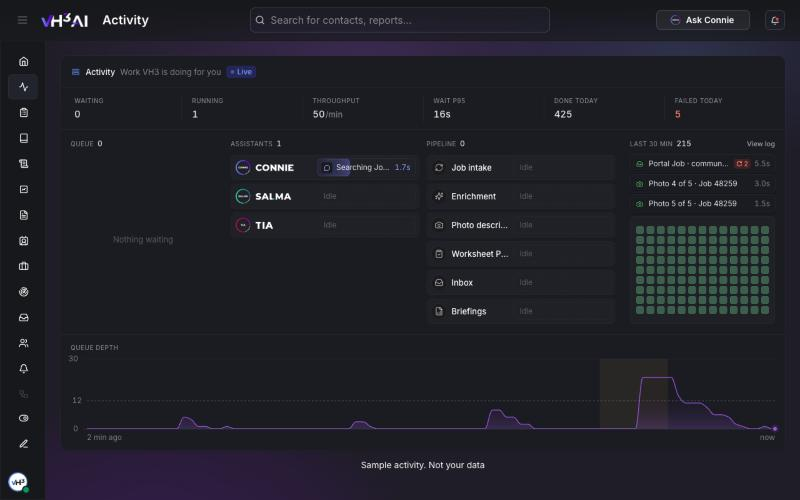

# Activity

**Activity** shows the work VH3 AI is doing for your company as it happens. Jobs syncing from your field system, photos being described, emails being triaged, briefings being written, and every turn with Connie, Salma or Tia appear here while they run, then move to the finished list.

**Path:** `/activity`

Every user can open Activity. It shows your own company's work only.

<Frame caption="Activity: the queue on the left, a lane for each assistant and each part of the pipeline, and the last 30 minutes of finished work on the right. Shown with sample activity.">
  
</Frame>

## Open Activity

1. Sign in at [app.vh3.ai](https://app.vh3.ai).
2. Select **Activity** in the sidebar, under Dashboard.
3. Leave the page open. It refreshes every couple of seconds while the tab is in view, and catches up when you come back to it.

The status next to **Work VH3 is doing for you** reads **Live** while work is running and **Idle** when nothing is. **Paused** with a countdown means an AI provider has asked VH3 AI to slow down for a moment. The work waits in the queue and carries on by itself.

## What the page shows

| Area | What it tells you |
|---|---|
| **Numbers row** | How much is waiting and running, how many tasks finish per minute, the longest recent wait, and **Done today** and **Failed today**, counted from midnight in your company's time zone |
| **Queue** | The next tasks waiting, with how long each has waited. Anything beyond the first few shows as small squares |
| **Assistants** | A lane each for Connie, Salma and Tia |
| **Pipeline** | A lane each for **Job intake**, **Enrichment**, **Photo describe**, **Worksheet Pass**, **Inbox** and **Briefings** |
| **Last 30 min** | The newest finished tasks, with older ones as small squares. Green is done, red is failed |
| **Queue depth** | How many tasks were waiting over the last 2 minutes |

A lane reads **Idle** when it has nothing running. When it gets busy it opens extra rows, one for each task running at the same time.

### What each lane covers

| Lane | Work you will see |
|---|---|
| **Connie** | Each chat turn, voice note, quick reply and hands-free call turn |
| **Salma** | Chat turns on a Quote Document, **Apply**, **Discard** and **Undo** on her proposals, Quote Runs, approval checks and estimates |
| **Tia** | Chat turns on a Library document |
| **Job intake** | Jobs syncing from your field system, jobs being read and indexed, Library documents being indexed, and imports |
| **Enrichment** | Jobs being enriched with what happened and why |
| **Photo describe** | Worksheet photos being described, for example **Photo 2 of 5 · Job 48213** |
| **Worksheet Pass** | Worksheet answers being rewritten |
| **Inbox** | Emails being triaged, including portal emails |
| **Briefings** | Engineer briefings, sentinel checks, reports, customer and account summaries, and investigations |

Tasks about a job carry the job's reference. Reading and searching inside a turn counts as part of that turn, so one question to Connie shows as one task.

### What an assistant is doing

While Connie, Salma or Tia works on a turn, the running bar says what they are doing at that moment. For example:

- **Searching Jobs**, **Looking up customers**, **Checking the schedule**
- **Reading the Library**, **Checking the weather**, **Building a report**
- **Reading the quote**, **Searching parts**, **Drafting changes**, **Updating the quote**
- **Writing the reply** once the answer is ready

## Look at one task

Hover a task to see its details. Click it, or press Enter, to keep the details open, and press Escape or **Close details** to close them. The details show the task's status, how long it waited and ran, its place in the queue, and which attempt it is on.

Activity is read-only. Tasks run and finish by themselves; the page shows you where each one is.

## The log

Choose **View log** at the top of **Last 30 min** to see everything that finished in the last hour, newest first. Each row shows the time, the task, its lane and how long it ran. A failed task says why in one sentence, for example *The photo could not be read.* Choose **Show 100 more** for older rows, and **Hide log** to close it.

## When to use Activity

- **After a sync or an import** — check that jobs are arriving and being read.
- **When Connie seems slow** — see whether she is working on your turn and what step she is on.
- **After a busy morning** — check **Failed today**, then open the log to see what failed and why.

## Related

- [Dashboard](/connect/dashboard)
- [Sentinels](/connect/sentinels)
- [Ask Connie](/connect/ask-connie)
- [Quote Documents](/connect/quote-documents)
