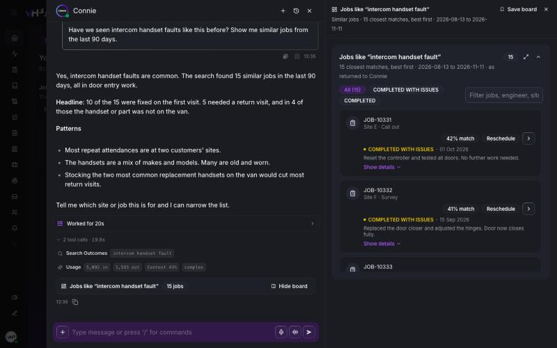
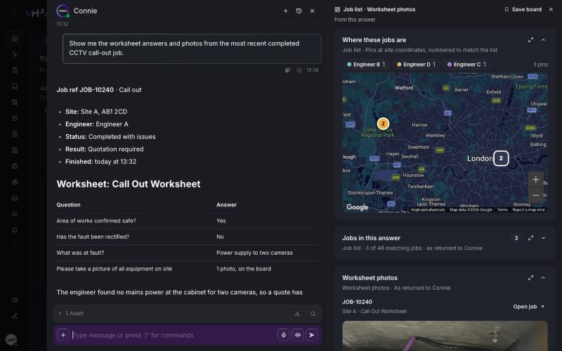
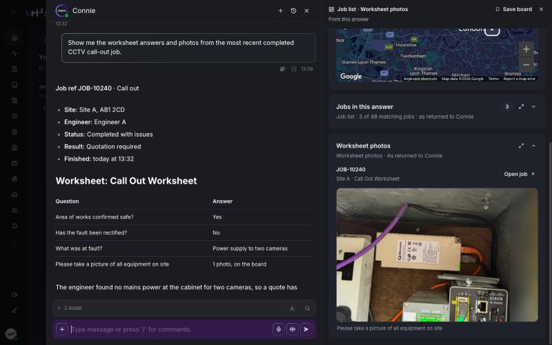
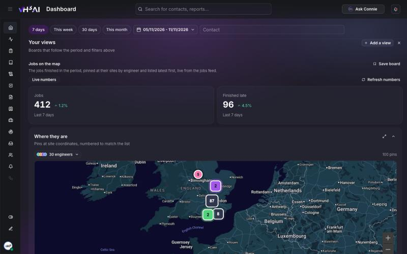
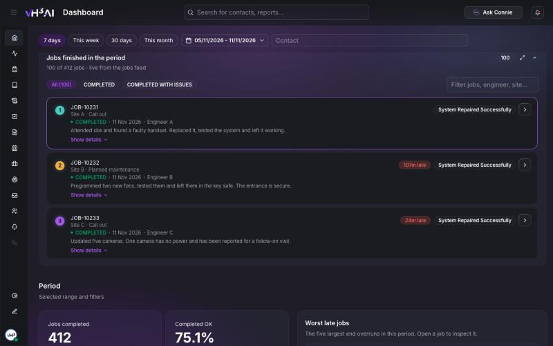

# Generative UI

When Connie answers with figures, the numbers behind her answer open on a **board** beside the chat. A board is a set of **cards**: counts, charts, a map of sites, job lists, finance summaries and more, built from the data Connie looked up. Open a job from the board, filter the list, expand a card, and save the board to come back to it. The Stats dashboard has boards too, under **Your views**.

<Frame caption="A board beside Connie's answer. Job references, sites and engineers are placeholders.">
  
</Frame>

## Boards beside Connie

1. Ask Connie a question that needs figures, for example *"How did the team do this month?"*, *"Give me a snapshot of this customer"*, or *"Have we seen this fault before?"*.
2. Under her reply, a bar names the board and what is on it, for example *2 KPIs · 1 chart · 12 jobs · map*.
3. On a wide screen the board opens in a column beside the chat. Choose **Hide board** or **Show board** under a reply to switch between boards, and **Close board** to close the column for this conversation.
4. On a narrow screen, and in job and contact chats, the board opens under the reply. Choose **Expand board** or **Collapse board**.

Each card is built straight from the data Connie looked up for her answer, so the board and the answer always show the same figures.

### Which questions bring a board

| Ask about | Board you get |
|---|---|
| A customer or account: a snapshot, a summary or a monthly report | Customer tiles such as **Jobs all time**, **Open jobs**, **Overdue** and **First-time fix**, with recent jobs, job types and engineers |
| How engineers or the team performed | **Engineers, ranked**, company benchmarks, and **About these numbers** |
| Whether you have seen a fault before | The closest matching jobs, and how those job types usually go |
| Counts, rates and trends | Count tiles, breakdowns and trend charts for the period |
| Invoices and quotes | Money tiles, status mix, trend, top customers and the largest records |
| Worksheets | Worksheet photos, with **Open job** and a full-size view. Needs [worksheet photos](/connect/worksheet-photos) switched on |
| Who could take a job | Scheduling suggestions |
| The weather for a job or site | The forecast |

<Frame caption="Ask for a job's worksheet and photos: the answer in the chat, the jobs pinned on a map beside it. Job references, sites and engineers are placeholders.">
  
</Frame>

<Frame caption="Further down the same board, the worksheet photo with the question it answers. Select the photo to see it full size, or Open job to go to the job.">
  
</Frame>

## Boards on the Dashboard

**Your views** sits at the top of the **Stats** tab: boards that follow the period and filters above them.

<Frame caption="Jobs on the map, a Dashboard preset. Counts are placeholders.">
  
</Frame>

1. Open **Dashboard** and stay on **Stats**.
2. Under **Your views**, pick a preset, or a board you saved:
   - **Jobs on the map**
   - **First-time fix next to SLA**
   - **Late jobs and overrun**
   - **Engineer workload**
   - **Outcomes and job types**
3. Change the period or the contact filter. The board follows.
4. Choose **Close view** when you are done.

## Cards you will see

| Card | What it shows |
|---|---|
| **Count tiles** | A number for the period, with the change against the previous period |
| **Breakdowns and trends** | Bars by job type, engineer or outcome, and a chart over time |
| **Map** | Pins at each site, numbered to match the job list and coloured by engineer. Overlapping pins group together; hover a pin to see its job. Filter the pins by engineer |
| **Job list** | Up to 100 jobs, with a filter box and status chips. Expand a row for details, or open the job |
| **Engineer ranking** | Engineers ranked by completion, on time, jobs or overrun, against company benchmarks |
| **Finance summary** | Invoice or quote totals, status mix, trend and the largest records |
| **Report and summaries** | Highlights, concerns and actions, in sections that fold |
| **Worksheet photos** | Photos from a job's worksheets, with a full-size view |
| **Weather** | The forecast for a job or site |

Every card has **Expand** to open it full size, and a control to fold it away.

<Frame caption="The job list card: filter, expand a row, or open the job. Job references, sites, engineers and notes are placeholders.">
  
</Frame>

### Live and fixed cards

- Count tiles, breakdowns and trend charts are **live**. Choose **Refresh numbers** to run them again.
- Job lists, reports and finance cards are a **copy** of what Connie looked up when she answered.

Select a job reference on any card to open the job over the board.

## Save a board

1. Choose **Save board** at the top of a board.
2. Give it a name, or keep the board's title, and choose **Save**.
3. Find it under **Your views → Saved boards** on the Dashboard.

A saved board from Connie keeps its job list as it was and runs its counts and charts again when you open it. A saved Dashboard board follows the Dashboard's period and filters. To remove a saved board, choose its delete button.

Saved boards are kept in the browser you saved them in, on that device only.

## Good to know

- Engineer rankings use operational figures only. Read them alongside what you know about each engineer's work, and not as grounds for employment decisions.
- Developers who want to build their own cards on VH3 AI data should read the [Generative UI guide](/guides/generative-ui).

## Related

- [Ask Connie](/connect/ask-connie)
- [Dashboard](/connect/dashboard)
- [Worksheet photos](/connect/worksheet-photos)
- [Jobs](/connect/jobs)
