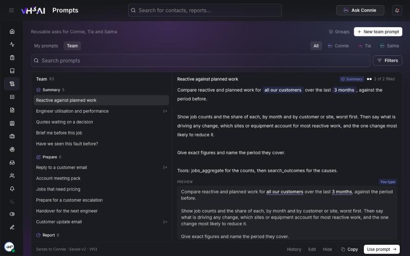

# Prompts

Prompts are the questions your team asks most, kept ready to send. Pick one, fill in any blanks, such as a customer or a date range, and send it to Connie, Tia or Salma. VH3 AI provides a library of prompts, your team can add its own, and you can keep personal ones.

**Path:** `/prompts`

<Note>
Prompts are switched on per company. If **Prompts** is missing from your sidebar, ask VH3 support to switch it on.
</Note>

<Frame caption="The Prompts page: groups of prompts on the left, the selected prompt and a preview on the right.">
  
</Frame>

## Use a prompt in a chat

1. In a chat with Connie, Tia or Salma, type `/`, or select **+** in the message box.
2. Open a group, such as **Summary**, **Prepare** or **Investigate**, or search.
3. Pick a prompt. If it has blanks, fill them in.
4. Send it.

Your most recent prompts sit at the top of the menu.

Blanks you fill in show blue. Blanks filled in from the page you are on, such as the job or customer open in front of you, show green.

## Browse the Prompts page

1. Select **Prompts** in the sidebar.
2. Choose **My prompts** for your own, or **Team** for VH3 AI's prompts and your team's.
3. Narrow the list to **Connie**, **Tia** or **Salma**, search, or use **Filters**.
4. Select a prompt to see its text and a preview with your blanks filled in.
5. Choose **Use prompt** to open the right chat with the prompt ready to send.

A Tia or Salma prompt first asks which document or quote it is about. The chips under each prompt show which assistant it **Sends to**.

## Add and edit prompts

- **Save to prompts** — under a message you sent, choose **Save to prompts** to keep it as your own prompt.
- **New prompt** — on **My prompts**, write a personal prompt.
- **New team prompt** — on **Team**, members who can edit team prompts add one for everybody.
- **Edit**, **Copy** and **Hide** — on **Team**, edit your team's prompts, make a team copy of a VH3 AI prompt to change it, or hide one your team does not use.
- **History** — every edit keeps the earlier versions. Open **History** to see them and restore one.

## Write prompts that work

- Name the output: a list, a table, three bullets for the standup, or a customer email.
- Name the period and the scope, or leave them as blanks.
- Say which figures matter, such as counts, shares or the worst sites first.

More habits for asking Connie: [Working with your operation](/guides/working-with-your-operation).

## Related

- [Ask Connie](/connect/ask-connie)
- [AI assistants](/connect/ai-assistants)
- [Knowledge base](/connect/knowledge-base)
- [Quote Documents](/connect/quote-documents)
