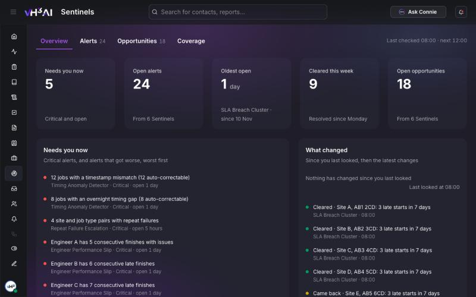
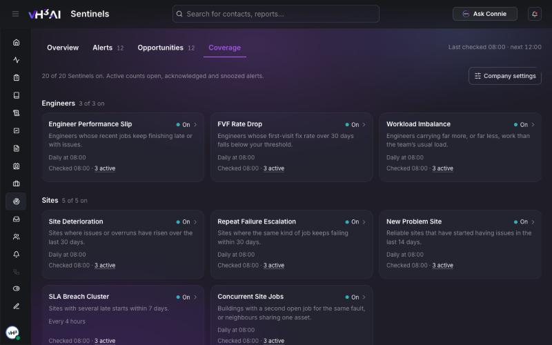
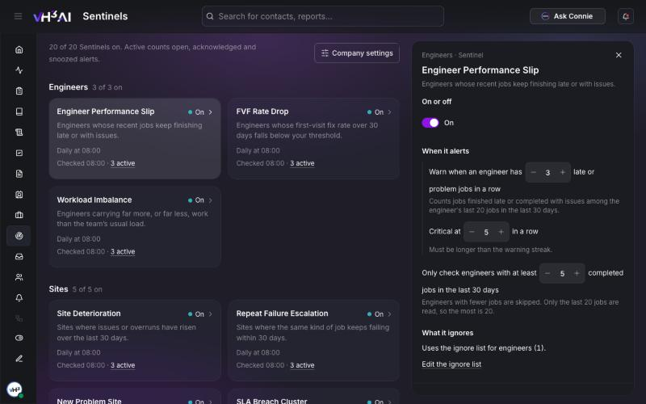

# Sentinels

**Sentinels** is where your team reviews what VH3 AI's sentinels have found: engineers slipping, sites getting worse, customers at risk, and work worth quoting. Open an alert to see why it fired and the jobs behind it, acknowledge it or snooze it, and tune each sentinel so it alerts at the level that suits your operation.

**Path:** `/sentinels`

<Note>
The Sentinels page is switched on per company. If **Sentinels** is missing from your sidebar, ask VH3 support to switch it on.
</Note>

<Frame caption="The Overview tab: what needs you now, and what changed since you last looked. Names and addresses are placeholders.">
  
</Frame>

## Who sees what

| Role | What they can do |
|---|---|
| **Admin** and **Manager** | See every alert, including engineer alerts, and change sentinel settings |
| **Other roles** | See site, customer, operations and opportunity alerts. Settings are read-only |

## The four tabs

The page opens on **Overview**. The line at the top right says when the sentinels last checked and when they check next.

### Overview

- **Tiles** — **Needs you now**, **Open alerts**, **Oldest open**, **Cleared this week** and **Open opportunities**. Each tile opens the matching list.
- **Needs you now** — critical alerts and alerts that got worse, worst first.
- **What changed** — a line such as *Since you last looked: 5 new · 2 got worse · 4 cleared*, then the latest changes with who made them and when.
- **Charts** — alerts opened and cleared over 30 days, open alerts by area and by severity, and the busiest sentinels.
- **Opportunities at a glance** — the opportunities ready to pursue.

If the sentinel checks are failing or switched off, a banner says so and warns that the page may be out of date.

### Alerts and Opportunities

**Alerts** lists risks. **Opportunities** lists work worth pursuing. Both group items by sentinel, worst first, and show a severity count in each group's header.

| Alerts | Opportunities | Means |
|---|---|---|
| **Open** | **Ready** | Needs a look |
| **Acknowledged** | **Acknowledged** | Someone has seen it |
| **Snoozed** | **Set aside** | Hidden until a date you chose |
| **Resolved** | **Resolved** | The sentinel stopped finding it |

Use **Filters** to narrow the list by area, severity or priority. Alerts use critical, warning and info. Opportunities use **Urgent**, **Act soon** and **Worth a look**.

### Coverage

**Coverage** shows every sentinel in a card, grouped by area: Engineers, Sites, Customers, Operations and Opportunities. Each card shows whether the sentinel is on, when it runs, when it last checked and how many alerts are active. Select a card to open its settings. **Company settings** opens the settings every sentinel shares.

<Frame caption="The Coverage tab: one card for each sentinel. Counts are placeholders.">
  
</Frame>

## Work an alert

1. Open **Alerts**, or select an alert under **Needs you now**.
2. Read the alert. On a wide screen it opens beside the list; on a phone it opens as a drawer.
   - **Why this fired** — the thresholds and the evidence.
   - **Involved** — the jobs behind the alert. Select a job reference to open the job.
   - **What to do** — the suggested next step.
   - **History** — who acknowledged or snoozed it, and when.
3. Choose an action:
   - **Acknowledge** — you have seen it and are dealing with it.
   - **Snooze** — hide it for 7, 14 or 30 days. On an opportunity this is **Not now**.
   - **Reopen** — put an acknowledged or snoozed alert back in the open list.
4. Each action shows **Undo** for a moment, in case you chose the wrong one.

An alert resolves by itself when the sentinel stops finding the problem. If the problem comes back later, it opens as a new alert. An acknowledged or snoozed alert reopens if it gets worse.

To keep a lasting record or hand an alert to an owner, open a [Case](/connect/cases) and assign a [Team](/connect/teams).

## Sentinel settings

Admins and managers change settings. Other roles see them read-only.

<Frame caption="Settings for one sentinel open beside the Coverage tab.">
  
</Frame>

### One sentinel

Open **Coverage** and select a sentinel.

- **On or off** — switching a sentinel off closes its active alerts. They are recorded as closed by the switch, not as cleared. Switch it back on and current findings return at the next check.
- **When it alerts** — each setting reads as a sentence, such as *Warn when an engineer has 3 late or problem jobs in a row*. A changed setting shows its default and a **Reset** button. Choose **Review** to see what will change, then **Save**.
- **What it ignores** — which ignore lists this sentinel uses, with a link to edit them.
- **When it runs** — the schedule and the next check. Most sentinels check daily at your company's set time. SLA Breach Cluster checks every 4 hours.
- **Changes** — who changed what, and when.

### Company settings

Select **Company settings** on the Coverage tab.

- **Ignore list** — add a site, customer, job type or engineer to leave it out of the sentinels that use that list. Alerts about it clear at the next check. Adding a parent customer offers to add its child accounts too.
- **Emails** — who receives sentinel emails. Recipients are admins or managers.
- **Lowest emailed severity** — email critical alerts only, warning and critical, or all three. Info alerts always show on the page; they are emailed only when this is set to include info.
- **Changes** — every settings change for your company.

## Sentinel emails

Sentinel emails carry what changed since the last one:

- **New** — alerts seen for the first time.
- **Got worse** — alerts whose severity rose.
- **Still open** — a reminder for alerts nobody has acted on: daily for critical, weekly for warning and info.

Acknowledged alerts, and snoozed alerts before their date, stay out of the email. When nothing is new, worse or due a reminder, no email is sent.

## The sentinels

| Area | Sentinel | What it looks for |
|---|---|---|
| Engineers | **Engineer Performance Slip** | Engineers whose recent jobs keep finishing late or with issues |
| Engineers | **FVF Rate Drop** | Engineers whose first-visit fix rate over 30 days falls below your threshold |
| Engineers | **Workload Imbalance** | Engineers carrying far more, or far less, work than the team's usual load |
| Sites | **Site Deterioration** | Sites where issues or overruns have risen over the last 30 days |
| Sites | **Repeat Failure Escalation** | Sites where the same kind of job keeps failing within 30 days |
| Sites | **New Problem Site** | Reliable sites that have started having issues in the last 14 days |
| Sites | **SLA Breach Cluster** | Sites with several late starts within 7 days |
| Sites | **Concurrent Site Jobs** | Buildings with a second open job for the same fault, or neighbours sharing one asset |
| Customers | **Customer Risk Escalation** | Customers whose late, unfinished and follow-up jobs add up to a high risk score |
| Customers | **Customer Non-Complete Anomaly** | Customers whose share of unfinished jobs has jumped |
| Operations | **Scheduling Accuracy Drift** | Job types that keep taking well over their planned time |
| Operations | **Carryover Accumulation** | A backlog of unfinished jobs that grows several days running |
| Operations | **Data Quality Alert** | Recent completed jobs with missing or inconsistent details |
| Operations | **Timing Anomaly Detector** | Jobs whose times don't add up, such as overnight gaps |
| Opportunities | **Dormant Customer Revival** | Customers with a good job history who have gone quiet for 6 months or more |
| Opportunities | **Service Interval Due** | Customers overdue for a service against their own usual interval |
| Opportunities | **Single Service Customer** | Customers with several jobs but only one type of work |
| Opportunities | **Engineer-Flagged Follow-Up** | Recent jobs where the engineer's notes mention a follow-up, parts, an upgrade or a quote |
| Opportunities | **Seasonal Uplift Window** | Customers who usually book a service this month and haven't yet this year |
| Opportunities | **Geographic Cluster Opportunity** | Customers near a site that recently had a service they don't buy yet |

How sentinels work and how to route their results: [Sentinels guide](/guides/sentinels). Running them from your own tools: [Sentinels API](/api-reference/sentinels).

## Related

- [Cases](/connect/cases)
- [Teams](/connect/teams)
- [Activity](/connect/activity)
- [Notifications](/connect/notifications)
