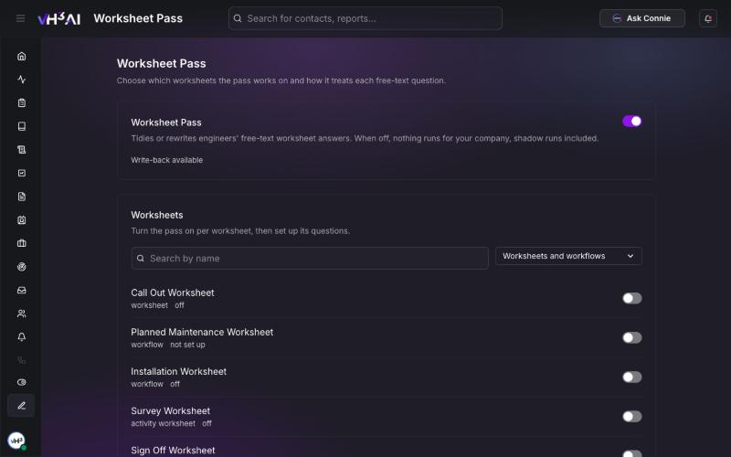
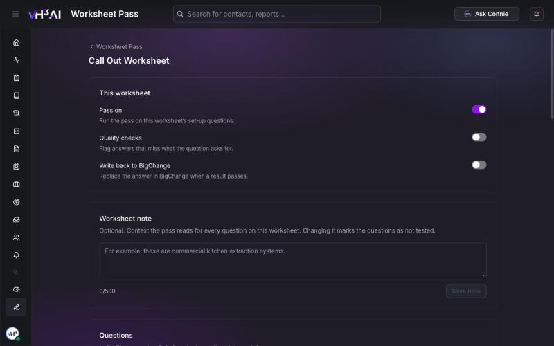
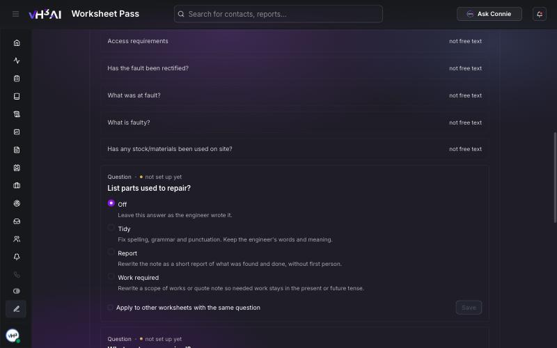

# Worksheet Pass

Worksheet Pass tidies or rewrites the free-text answers engineers write on their worksheets. Choose which worksheets it works on and, for each free-text question, how it treats the answer: fix the spelling and grammar, turn the note into a short report, or keep needed work in the future tense. Every result is checked before it can be used. Try your settings on real answers before you save them.

**Path:** `/settings/worksheet-pass`

Admins only. **Worksheet Pass** sits at the bottom of the sidebar.

<Frame caption="The Worksheet Pass page: the company switch, then every worksheet from your field system. Worksheet names are placeholders.">
  
</Frame>

## How it works

1. An engineer completes a job and fills in its worksheet.
2. After VH3 AI has read the job, Worksheet Pass reads the free-text answers on worksheets you have switched on.
3. For each question with a style, it writes a new version of the answer.
4. A checker compares the new version with what the engineer wrote. It blocks a change that adds something the engineer did not say, leaves out a location, a reason or a next step, makes something uncertain sound certain, or changes whether work was done or is still needed.
5. With **Write back to BigChange** on, a result that passes replaces the answer in BigChange. A job note titled **VH3 Rewrite** keeps the engineer's original text.

Worksheet Pass leaves alone worksheets that are switched off, questions set to **Off**, and every question that is not free text, such as yes or no, lists, numbers, dates, photos and signatures. Work that is needed or quoted is never written up as done.

You can follow it on the [Activity](/connect/activity) page, in the **Worksheet Pass** lane.

## Switch it on

1. Open **Worksheet Pass** at the bottom of the sidebar.
2. Turn on the **Worksheet Pass** switch at the top. When it is off, nothing runs for your company.
3. Under **Worksheets**, find a worksheet with **Search by name**, or narrow the list to **Worksheets** or **Workflows**.
4. Open the worksheet. If it says **Not set up yet**, choose **Set up worksheet**.
5. Choose a style for each free-text question, try it, and save. See below.
6. Turn on **Pass on** for the worksheet.

A worksheet marked **changed in BigChange since set-up** has new or changed questions. Open it to set them up.

## Set up a worksheet

<Frame caption="This worksheet: the pass, quality checks and write-back each have their own switch. The worksheet name is a placeholder.">
  
</Frame>

### This worksheet

| Switch | What it does |
|---|---|
| **Pass on** | Run the pass on this worksheet's set-up questions |
| **Quality checks** | Flag answers that miss what the question asks for |
| **Write back to BigChange** | Replace the answer in BigChange when a result passes. Turning it on asks you to confirm |

All three start off. The status under the company switch says whether write-back is available for your company yet. Until it is, the write-back switch is greyed out. Ask VH3 support when you are ready to write back.

### Worksheet note

An optional note, up to 500 characters, that the pass reads for every question on this worksheet. For example: *these are commercial kitchen extraction systems.* Changing it marks the questions as not tested, so try them again.

### Questions

Questions are listed in BigChange order. Only free-text questions take a style; the rest are marked **not free text**. When new free-text questions appear in BigChange, a banner offers **Add them to settings**. They are added as **Off**.

<Frame caption="Each free-text question takes one of four styles.">
  
</Frame>

| Style | What it does |
|---|---|
| **Off** | Leave this answer as the engineer wrote it |
| **Tidy** | Fix spelling, grammar and punctuation. Keep the engineer's words and meaning |
| **Report** | Rewrite the note as a short report of what was found and done, without first person |
| **Work required** | Rewrite a scope of works or quote note so needed work stays in the present or future tense |

For each question you can also set:

- **Voice** — the style's default, **Impersonal**, or **As written**.
- **Length** — the style's default, **Tight**, **Standard** or **Loose**. A result outside the range does not pass.
- **Guidance for this question** — up to 500 characters on what this question is for. VH3 AI may suggest guidance from your engineers' past answers; choose **Use and try it** or **Dismiss**.

Tick **Apply to other worksheets with the same question** to use the same settings wherever that question appears, then choose **Save**.

A badge shows when a newer version of a style is available; choose **Upgrade to version N** to use it.

## Try it before you save

Choose **Try it on a real answer** on a question. Pick one of your engineers' recent answers to that question, newest first, or paste one. Try it runs the settings on screen on that answer and shows the result. Nothing is stored or written to BigChange.

| Result | Means |
|---|---|
| **Would pass** | The change passed every check |
| **Would not pass** | A check blocked it. The reasons are listed, with links to change the voice or length |
| **Would be left as written** | The answer needed no change |
| **Could not be checked** | Try again |

New or changed guidance can only be saved after you have tried it. Each question shows whether it is **tested**, or **not tested since last change**. Your company can run Try it 50 times in any 24 hours.

## Checker tolerance

**Checker tolerance** sets how strict the checker is for each kind of mistake, under **Rewrites** and **Tidy-ups**. Lower is stricter. Leave it on the standard tolerance unless VH3 support has agreed a change with you.

## Related

- [Worksheet photos](/connect/worksheet-photos)
- [Activity](/connect/activity)
- [Jobs](/connect/jobs)
- [Integrations](/connect/integrations)
