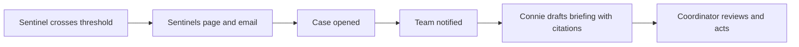

Riccardo Vezza · May 2026 · Updated November 2026

<Card title="Do this in Connect" icon="laptop" href="/connect/sentinels">
  Review alerts and opportunities, acknowledge or snooze them, and tune each sentinel on the **Sentinels** page in VH3 Connect.
</Card>

Sentinels are VH3 AI's proactive monitoring layer. They check your operational data on a schedule to detect emerging risks and growth opportunities while there is still time to act. Most sentinels check daily at your company's set time; SLA Breach Cluster checks every 4 hours. Detection is a structured graph read, with near-zero AI cost at the watch layer.

For operators, a sentinel is the morning signal that something changed: repeat visits on one account, SLA slips in a region, a dormant customer worth calling, or an engineer-flagged follow-up that needs a quote.

## How sentinels work

Every sentinel is a **structured read on the operational model:** a query against the intelligence layer that evaluates a specific operational signal against configurable thresholds. Conversational AI is only invoked if you choose to generate a narrative explanation or briefing from the result.

<Steps>
  <Step title="Detection">
    The sentinel query runs against your graph, looking for the pattern it's designed to detect (e.g. repeat visits at a site exceeding threshold).
  </Step>
  <Step title="Scoring">
    Results are scored as critical, warning or info. Each sentinel's settings decide what counts as a warning and what counts as critical.
  </Step>
  <Step title="Memory">
    Each alert keeps its identity from one check to the next. VH3 AI knows whether it is new, got worse, or is still open, and resolves it when the sentinel stops finding the problem.
  </Step>
  <Step title="Delivery">
    Alerts show on the Sentinels page in Connect and in sentinel emails. They are also available through the API, and can be routed to Slack, Teams, email, or WhatsApp via automation.
  </Step>
</Steps>

## Configuration

Admins and managers tune sentinels on the [Sentinels page](/connect/sentinels#sentinel-settings) in Connect.

| Setting | Where | What it does |
|---|---|---|
| **On or off** | Each sentinel | Switching a sentinel off closes its active alerts |
| **When it alerts** | Each sentinel | The thresholds for warning and critical, written as sentences, such as how many late jobs in a row |
| **Ignore list** | Company settings | Sites, customers, job types and engineers to leave out. Each sentinel uses the lists that fit what it watches |
| **Emails** | Company settings | Who receives sentinel emails |
| **Lowest emailed severity** | Company settings | Email critical only, warning and critical, or all three |

Every change is recorded with who made it and when.

## Alerts and emails

Sentinel emails carry what changed since the last one:

- **New** — seen for the first time.
- **Got worse** — the severity rose. This also reopens an acknowledged or snoozed alert.
- **Still open** — a reminder: daily for critical, weekly for warning and info.

Acknowledged alerts, and snoozed alerts before their date, stay out of the email. When nothing has changed, no email is sent. Info alerts always show on the Sentinels page, and are emailed only when the lowest emailed severity includes info.

## Operational sentinels

Fourteen operational sentinels watch for emerging risks across engineers, sites, customers and operations:

| Area | Sentinels |
|---|---|
| Engineers | Engineer Performance Slip, FVF Rate Drop, Workload Imbalance |
| Sites | Site Deterioration, Repeat Failure Escalation, New Problem Site, SLA Breach Cluster, Concurrent Site Jobs |
| Customers | Customer Risk Escalation, Customer Non-Complete Anomaly |
| Operations | Scheduling Accuracy Drift, Carryover Accumulation, Data Quality Alert, Timing Anomaly Detector |

A few examples:

### Engineer Performance Slip

Detects engineers whose recent jobs keep finishing late or completed with issues. Catches problems early, before a pattern becomes a client complaint.

### Site Deterioration

Identifies sites where issues or overruns are rising over the last 30 days. Surfaces sites that may need a planned maintenance visit to reduce continued reactive attendance.

### SLA Breach Cluster

Finds sites with several late starts within 7 days. Distinguishes between isolated misses and systemic problems.

### Concurrent Site Jobs

Flags a building with a second open job for the same fault, raised under a different order, or neighbouring properties sharing one asset such as a gate, aerial or entry panel. Each job is checked again in your field system before the alert is raised.

### Scheduling Accuracy Drift

Flags job types that keep taking well over their planned time. Useful when planning assumptions have drifted from reality.

### Data Quality Alert

Surfaces recent completed jobs with missing or inconsistent details, helping keep the intelligence layer clean.

## Growth opportunity sentinels

Six growth sentinels surface revenue opportunities hiding in your operational history:

### Dormant Customer Revival

Identifies customers with a good job history who have gone quiet for 6 months or more. Useful for re-engagement and churn-risk review.

### Service Interval Due

Flags customers overdue for a service against their own usual interval, creating maintenance-contract review opportunities.

### Single Service Customer

Finds customers with several jobs but only one type of work, with evidence for cross-sell conversations.

### Engineer-Flagged Follow-Up

Surfaces recent jobs where the engineer's notes mention a follow-up, parts, an upgrade or a quote, so missed quote or revisit opportunities can be reviewed.

### Seasonal Uplift Window

Identifies customers who usually book a service this month and haven't yet this year, supporting proactive outreach.

### Geographic Cluster Opportunity

Finds customers near a site that recently had a service they don't buy yet, where one visit could cover several nearby conversations.

## API access

Sentinels can be run on demand, and their latest results read back.

| Action | Endpoint | Typical use |
|--------|----------|-------------|
| Run sentinels | `POST /sentinels/run` | Test a specific pattern or trigger an automation |
| Run one sentinel | `POST /sentinels/run/{sentinel_id}` | Check one signal |
| Read the latest results | `GET /sentinels/results` | Morning ops review, channel summary, or a report section |
| List sentinels | `GET /sentinels/registry` | Sentinel IDs, settings and defaults |

Full details: [Sentinels API](/api-reference/sentinels).

## Automation

Sentinel results are most powerful when routed automatically. Common patterns:

- **Daily Slack digest:** summary of all sentinel triggers posted to an ops channel each morning
- **Email alerts:** critical sentinels (SLA breach cluster, site deterioration) sent to account managers immediately
- **Weekly report inclusion:** sentinel results embedded in weekly operational reports
- **Case creation:** high-severity triggers automatically create a case for follow-up
- **WhatsApp notifications:** urgent alerts routed to field managers on the move

All of these are achievable via the VH3 AI n8n nodes (100+ pre-built templates) or direct API integration.

## From signal to ownership

A useful sentinel result should have somewhere to go. Acknowledge it on the Sentinels page so the team knows it is in hand. High-severity triggers can open a **case**, attach the relevant jobs or customer records, and assign ownership to the team responsible for that account, region, or function.

Example flow:

1. Repeat Failure Escalation flags a customer site with three fire-panel callouts in six weeks.
2. The alert appears under **Needs you now** and in the morning sentinel email.
3. The coordinator acknowledges it, opens a case, attaches the jobs, and assigns the regional team.
4. Connie drafts a short briefing with the cited job references for the coordinator.

## Related

<CardGroup cols={2}>
  <Card title="Sentinels in Connect" icon="laptop" href="/connect/sentinels">
    Review alerts, act on them, and change settings.
  </Card>
  <Card title="Working with your operation" icon="user-tie" href="/guides/working-with-your-operation">
    How operators use sentinels in the daily rhythm.
  </Card>
  <Card title="Reports" icon="chart-line" href="/guides/reports">
    Include sentinel results in scheduled operational reporting.
  </Card>
  <Card title="Operational discovery" icon="magnifying-glass" href="/guides/operational-discovery">
    Run precedent searches after a sentinel flags a pattern.
  </Card>
</CardGroup>
